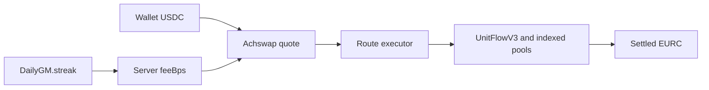

# Nexio

USDC and EURC treasury on Arc Mainnet (chain ID 5042). Swap amounts come from the Achswap Developer API. Names, streaks, and vault balances are read from the contracts below.

## Architecture

```text
Browser
  |-- balances, vaults, Daily GM, .nex names, liquidity
  |     `-- https://rpc.mainnet.arc.io
  |
  `-- USDC <-> EURC
        `-- POST /api/achswap/quote
        `-- POST /api/achswap/swap
              `-- https://trade.achswap.app/api/v1
                    Authorization and x-api-key stay on the server
```



Native USDC and ERC-20 USDC `0x3600000000000000000000000000000000000000` are one balance. Native units use 18 decimals. The ERC-20 uses 6. `1` USDC native is `10^18`. The same USDC as ERC-20 is `10^6`.

## Arc Mainnet contracts

| Contract | Address |
| --- | --- |
| ArcNameService | [0xE3FdB021493953C95F4c93bCCF83B762e4475Ed7](https://explorer.arc.io/address/0xE3FdB021493953C95F4c93bCCF83B762e4475Ed7) |
| DailyGM | [0x609A9D897DB4c554a03d4304c8EF42b56ea32e31](https://explorer.arc.io/address/0x609A9D897DB4c554a03d4304c8EF42b56ea32e31) |
| NexioEURCVault | [0xb30c9272a28749Ae0B04E1d5977337a570025009](https://explorer.arc.io/address/0xb30c9272a28749Ae0B04E1d5977337a570025009) |
| NexioUSDCVault | [0x045700Cd0D442E65dcB549330580d9981bcbC5E0](https://explorer.arc.io/address/0x045700Cd0D442E65dcB549330580d9981bcbC5E0) |
| NexioSwap | [0xD3504e2118b1c7a52cf44947510633562635ee03](https://explorer.arc.io/address/0xD3504e2118b1c7a52cf44947510633562635ee03) |

| Token | Address | Decimals |
| --- | --- | --- |
| USDC | `0x3600000000000000000000000000000000000000` | 6 as ERC-20, 18 as native gas |
| EURC | `0xbEf5f6d51CB62b58e6A8f77868681825C6fe21c1` | 6 |

## Achswap

The browser never calls `trade.achswap.app`. `app/api/achswap/[action]/route.ts` checks the body, forces chain ID `5042`, and attaches `ACHSWAP_API_KEY`.

Identical quotes share one upstream request and a 3-second success cache. HTTP 429 is retried. Swap requests are not cached.

Portfolio mark: quote exactly 1 EURC to USDC with `feeBps` 0. The screen shows `formatUnits(amountOut, 6)` with no rounding.

Swap quote and swap execution send the connected wallet. The server reads `DailyGM.streak` and sets the partner fee. The client cannot choose `feeBps`. The receive field is that response's `amountOut`. The minimum is `minAmountOut`.

If Achswap rejects the partner fee, the proxy retries once with `feeBps` 0 so the swap can still be built.

Before the wallet signs, Nexio approves the spender, waits for `tx.wait(1)`, re-reads `allowance`, and only then requests the `/swap` payload that will be signed. `to`, hex `data`, non-negative `value`, and chain ID `5042` are checked first.

USDC Max on Send, Swap, vault deposit, and liquidity leaves 0.005 USDC for gas.

## .nex names

`NexNameService.register` stores one name per address and one owner per name.

- `hasDomain(wallet)` is true: registration is blocked and the bound name is shown.
- `isAvailable(name)` is false, or `resolve(name)` is not the zero address: the name is permanently unavailable.
- Identity Vault calls `resolveByAddress(wallet)` and checks `resolve(name)` returns the same wallet.
- Sync writes that name into the profile and Nexio Pass. Clearing the browser does not clear the chain.

## Daily GM tiers

`checkIn()` requires 24 hours and increments `streak`. There is no reward token.

| Streak | feeBps | Batch recipients | Status |
| --- | --- | --- | --- |
| 0–6 days | 20 | 5 | Standard |
| 7+ days | 15 | 15 | Verified Active Sender |
| 30+ days | 10 | 30 | Priority LP pool analytics |
| 90+ days | 5 | 50 | Vault telemetry |
| 180+ days | 0 | Unlimited | VIP on Swap, Send, Receive, and Liquidity |

`feeRecipient` is `ACHSWAP_FEE_RECIPIENT`, or `0x9AFe5CeF11fC10756faef213f7A30D9873B5d372` when that variable is empty. `feeBps` 0 omits the recipient.

## Liquidity guard

The V2 reserve ratio is compared with the live 1 EURC Achswap `amountOut`. A gap above 5% blocks `addLiquidity`. `removeLiquidity` stays available.

## Documentation

The in-app Documentation tab and `/docs` use the same guide. Plain text is at `/docs.txt` and `/llms.txt`.

## Production setup

Requirements: Node.js 20+, npm, and a wallet that can add Arc Mainnet.

```bash
npm install
copy .env.example .env.local
npm run dev
```

`.env.local` is gitignored.

```bash
ACHSWAP_API_KEY=your_server_key
ACHSWAP_FEE_RECIPIENT=0x9AFe5CeF11fC10756faef213f7A30D9873B5d372
```

Do not prefix the Achswap key with `NEXT_PUBLIC_`. Contract address variables in `.env.example` override the deployed addresses above when set.

```bash
npx tsc --noEmit
npx next build
npm start
```

Hardhat deploy, when needed, uses `PRIVATE_KEY` in `.env` and the `arc_mainnet` network only.

| Command | What it does |
| --- | --- |
| `npm run dev` | Next.js dev server |
| `npm run build` | Production build |
| `npm start` | Serve the production build |
| `npm run compile` | Compile the Solidity contracts |
| `npm run deploy:mainnet` | Deploy with `scripts/deploy_mainnet.ts` on `arc_mainnet` |
