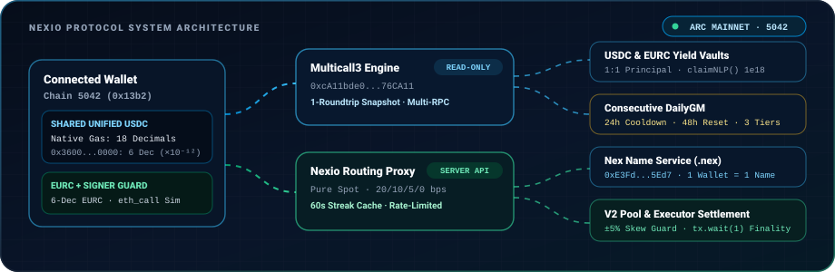
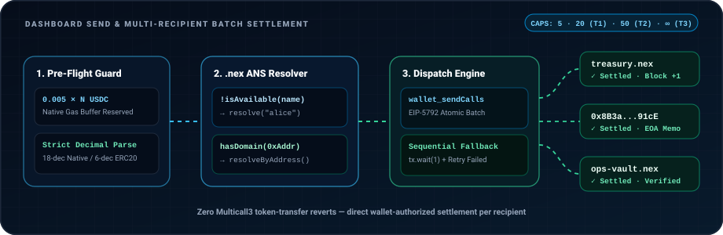
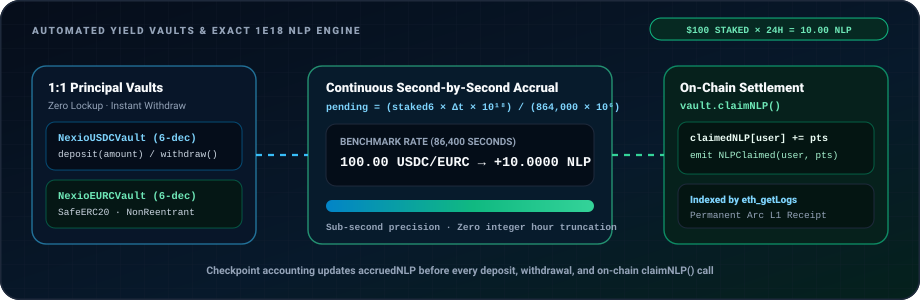
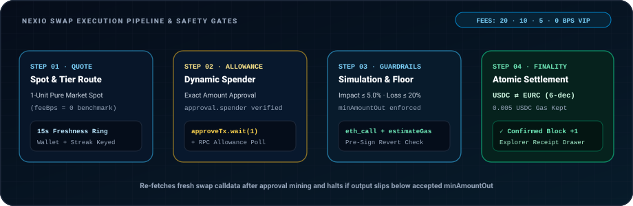
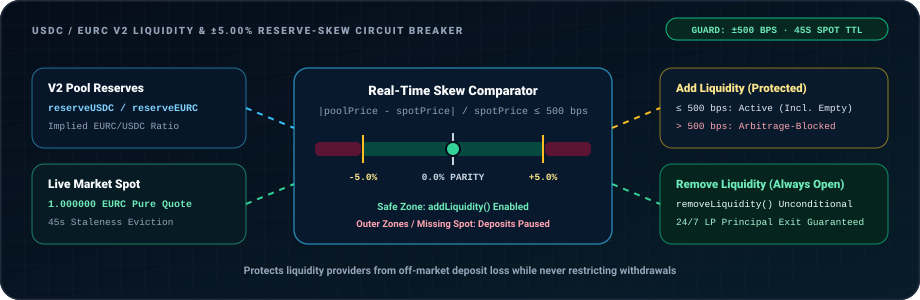
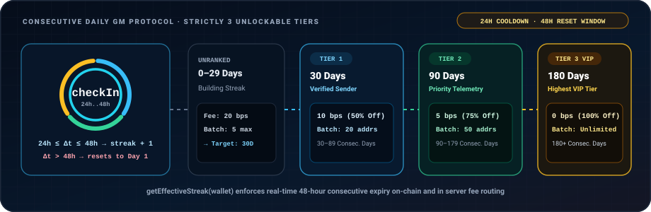
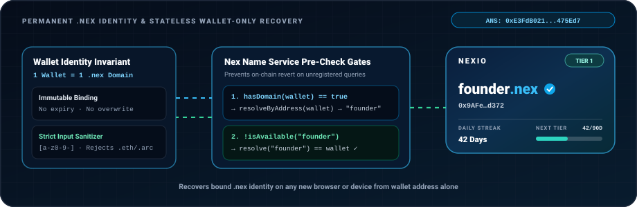
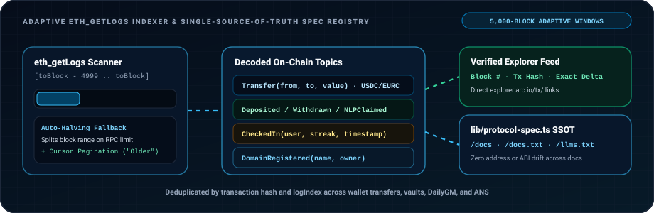

<p align="center">
  
</p>

<h1 align="center">Nexio Protocol</h1>

<p align="center">
  <strong>Enterprise Stablecoin Banking, Automated Yield Vaults &amp; Permanent .nex Identity on Arc Mainnet</strong>
</p>

<p align="center">
  <a href="https://explorer.arc.io"></a>
  
  
  
</p>

---

## System Architecture & Dual-Decimal USDC State

<p align="center">
  
</p>

| Parameter | Canonical Value |
| --- | --- |
| Protocol | **Nexio Protocol** |
| Network | `Arc Mainnet` — Chain ID `5042` (`0x13b2`) |
| Primary RPC | `https://rpc.mainnet.arc.io` (supports comma-separated `NEXT_PUBLIC_ARC_RPC_URLS` failover) |
| Block Explorer | [https://explorer.arc.io](https://explorer.arc.io) |
| Native L1 Gas Asset | `USDC` (`18` decimals via `eth_getBalance`) |
| Official `USDC` ERC-20 Precompile | [`0x3600000000000000000000000000000000000000`](https://explorer.arc.io/address/0x3600000000000000000000000000000000000000) (`6` decimals) |
| Official `EURC` ERC-20 | [`0xbEf5f6d51CB62b58e6A8f77868681825C6fe21c1`](https://explorer.arc.io/address/0xbEf5f6d51CB62b58e6A8f77868681825C6fe21c1) (`6` decimals) |
| Max Spend Gas Reserve | `0.005 USDC` (`5 * 10^15` native wei / `5,000` ERC-20 units; scaled `× N` in sequential batch mode) |
| Automated Vault NLP Rate | `$100 USD` staked = exact `10.00 NLP` per `24 hours` (`86,400s`), settled on-chain via `claimNLP()` |
| Daily GM Window | `24h` (`86,400s`) check-in cooldown · strict `48h` (`172,800s`) consecutive streak window |
| Protocol Fee Treasury | [`0x9AFe5CeF11fC10756faef213f7A30D9873B5d372`](https://explorer.arc.io/address/0x9AFe5CeF11fC10756faef213f7A30D9873B5d372) (`ACHSWAP_FEE_RECIPIENT`) |
| Solidity Compiler | `0.8.24` (optimizer enabled, `200` runs; contract pragma `^0.8.19`) |

**Shared Native / ERC-20 `USDC` Precompile & Pure Two-Sided Market Spot:**
- **Single Account Balance:** Native gas `USDC` (`18` decimals) and ERC-20 `USDC` at `0x3600000000000000000000000000000000000000` (`6` decimals) expose **one shared underlying balance** scaled by `10^12` (`1 USDC = 10^18 native wei = 10^6 ERC-20 units`). Portfolio Net Worth counts wallet `USDC` **once** (`rawNativeWei / 10^12`) and never calls WETH9 `deposit()`/`withdraw()` on `0x3600000000000000000000000000000000000000`.
- **Pure Unskewed Two-Sided Spot (`spotOnly: true, feeBps: 0`):** `EURC` is never treated as `1:1` with `USDC`. Live USD valuation queries both `1 EURC -> USDC` and `1 USDC -> EURC` in parallel with `spotOnly: true` and `feeBps: 0` (skipping `DailyGM` fee injection), computing exact mid-spot `(bidOut + impliedAskOut + 1n) / 2n` when two-way spread `<= 400 bps` to cancel symmetric AMM pool swap fees to within `< 0.05 bps` of true mid-market spot (`30s` active TTL, `45s` hard staleness eviction).

---

## Arc Mainnet Contracts, Tokens & Infrastructure (`5042`)

| Entity | Solidity / Source | Address | Decimals | Deployment Tx / Role |
| --- | --- | --- | --- | --- |
| **USDC** | Native + ERC-20 Precompile | [`0x3600000000000000000000000000000000000000`](https://explorer.arc.io/address/0x3600000000000000000000000000000000000000) | `6` (ERC-20) / `18` (Native) | System precompile (shared balance scaled by `10^12`) |
| **EURC** | `IERC20` | [`0xbEf5f6d51CB62b58e6A8f77868681825C6fe21c1`](https://explorer.arc.io/address/0xbEf5f6d51CB62b58e6A8f77868681825C6fe21c1) | `6` | Canonical Euro Coin on Arc Mainnet |
| **ArcNameService** | `NexNameService` (`contracts/ArcNameService.sol`) | [`0xE3FdB021493953C95F4c93bCCF83B762e4475Ed7`](https://explorer.arc.io/address/0xE3FdB021493953C95F4c93bCCF83B762e4475Ed7) | N/A | [Tx `0x26029fb3…1d7e`](https://explorer.arc.io/tx/0x26029fb3b4b05c7a8fea159b451918edecef2b58b1cac1acc7a8e917d37f1d7e) — Permanent 1-wallet-1-`.nex` registry |
| **DailyGM** | `DailyGM` (`contracts/DailyGM.sol`) | [`0x1A85147a0b372A56A2C93515E44d99d062264c54`](https://explorer.arc.io/address/0x1A85147a0b372A56A2C93515E44d99d062264c54) | N/A (`uint256`) | [Tx `0x6eb85765…c925`](https://explorer.arc.io/tx/0x6eb85765b16abaff3884786361ab3aa6c0954e16731edf127c88ee9a79f6c925) — 24h cooldown & 48h consecutive streak engine |
| **NexioUSDCVault** | `NexioUSDCVault` (`contracts/NexioUSDCVault.sol`) | [`0x77e46702C82f16D6227686e0ED8882c3cf44e599`](https://explorer.arc.io/address/0x77e46702C82f16D6227686e0ED8882c3cf44e599) | `6` / `18` (`NLP`) | [Tx `0x14a46165…446c`](https://explorer.arc.io/tx/0x14a46165848c706191f0ab72640c4c421272894b1fa1786af15e84b8fc3f446c) — 1:1 `USDC` vault & `claimNLP()` engine |
| **NexioEURCVault** | `NexioVault` (`contracts/NexioVault.sol`) | [`0xfE128bCc8F4D45AB9E24bF446EEa8302d1FD4CB7`](https://explorer.arc.io/address/0xfE128bCc8F4D45AB9E24bF446EEa8302d1FD4CB7) | `6` / `18` (`NLP`) | [Tx `0x8328d478…4aed`](https://explorer.arc.io/tx/0x8328d47886ad4844ca1e62864f4ebbe7eb472b8955fb7687a749394b36214aed) — 1:1 `EURC` vault & `claimNLP()` engine |
| **NexioSwap** | `NexioSwap` (`contracts/NexioSwap.sol`) | [`0xD3504e2118b1c7a52cf44947510633562635ee03`](https://explorer.arc.io/address/0xD3504e2118b1c7a52cf44947510633562635ee03) | `6` (`USDC`/`EURC`) | [Tx `0xd0257d93…858c`](https://explorer.arc.io/tx/0xd0257d930ac6c195b60f282a00ccded4bf9100497e8ebcb77bb44addf1bb358c) — *Standalone V2 wrapper (see note)* |
| **V2 Liquidity Router** | `IV2LiquidityRouter` | [`0x52FE40c00530db2e43d01652f903870571A14AFD`](https://explorer.arc.io/address/0x52FE40c00530db2e43d01652f903870571A14AFD) | `6` / `18` LP | Direct router called by the UI Liquidity module |
| **V2 Pair Factory** | `IV2PairFactory` | [`0xb0C2B0acb9c13079dDd871eDaF43Aabf6e88C530`](https://explorer.arc.io/address/0xb0C2B0acb9c13079dDd871eDaF43Aabf6e88C530) | N/A | Resolves the `USDC`/`EURC` V2 liquidity pair |
| **Multicall3** | `IMulticall3` | [`0xcA11bde05977b3631167028862bE2a173976CA11`](https://explorer.arc.io/address/0xcA11bde05977b3631167028862bE2a173976CA11) | N/A | **Strictly read-only** `aggregate3` snapshot batcher |

> **Routing Note (`NexioSwap` vs. UI Routing):** UI Swaps execute against the dynamic `swap.tx.to` settlement executor returned by `/api/achswap/swap`, and UI Liquidity calls the V2 Liquidity Router (`0x52FE40c00530db2e43d01652f903870571A14AFD`) directly. `NexioSwap` (`0xD3504e2118b1c7a52cf44947510633562635ee03`) is deployed as a standalone V2 wrapper contract for direct smart-contract integrations.

---

## Protocol Modules & Animated Execution Flows

### 1. Dashboard Send, Local QR & Multi-Recipient Batch Settlement

<p align="center">
  
</p>

- **Zero-Leak On-Device QR:** Generates ISO/IEC 18004 Reed-Solomon SVG QR codes locally on-device with zero external image requests.
- **Batch Reads vs. Batch Writes:** `Multicall3` (`0xcA11bde05977b3631167028862bE2a173976CA11`) is used **strictly for batched `eth_call` reads** (`batchResolveRecipients` for single and comma-separated `.nex` entries). Multi-recipient Batch Transfer **writes** execute via EIP-5792 `wallet_sendCalls` when supported by the wallet, with automatic fallback to sequential `prepareAndSendTx` settlements and 1-click `Retry Remaining` recovery.

### 2. Automated Yield Vaults & Exact `10.00 NLP / $100 / 24h` Engine

<p align="center">
  
</p>

- **1:1 Non-Custodial Principal:** `NexioUSDCVault` (`0x77e46702C82f16D6227686e0ED8882c3cf44e599`) and `NexioEURCVault` (`0xfE128bCc8F4D45AB9E24bF446EEa8302d1FD4CB7`) custody 6-decimal `USDC`/`EURC` with `nonReentrant` protection and return exact `1:1` principal on `withdraw(amount)`.
- **Exact `1e18` NLP Formula:** Points accrue continuously per second on-chain:
  `deltaPoints18 = (stakedBalance * 1e12 * elapsed) / 864000`
  Staking `$100 USD` (`100 * 10^6` units) for `24 hours` (`86,400s`) accrues **exact `10.00 NLP`** (`10 * 10^18`), normalized in USD for `EURC` via `computeUsdScaledVaultNlp18` against live market spot.
- **On-Chain `claimNLP()` Settlement:** Pending points settle on-chain via `claimNLP()`, moving `accruedPoints[msg.sender]` into `claimedPoints[msg.sender]` and emitting `NLPClaimed(user, amount, totalClaimed, timestamp)` (zero self-transfers).

### 3. Protected Swap Execution Pipeline (`/api/achswap/quote` & `/api/achswap/swap`)

<p align="center">
  
</p>

- **Server Credential Isolation & Resilience:** `app/api/achswap/[action]/route.ts` validates JSON inputs, locks `chainId === 5042`, enforces a `60 req/60s` per-IP sliding window and `8,000 ms` timeout, deduplicates identical quotes for `3,000 ms` (`max 200` keys), and retries HTTP `429` at `[0, 400, 900] ms` (`Retry-After <= 5,000 ms`) on both `/quote` and `/swap`.
- **Authoritative Streak Fee & Targeted `0 bps` Fallback:** Client `feeBps` is ignored. For user swap quotes, the server reads `DailyGM.getEffectiveStreak(trader)` (`60,000 ms` TTL + `stale-if-error`) and injects `20 / 10 / 5 / 0 bps` routed to `0x9AFe5CeF11fC10756faef213f7A30D9873B5d372` (omitted at `0 bps`). If upstream returns `400`/`422` citing `fee`, `feebps`, `feerecipient`, or `partner`, the proxy retries once at `feeBps: 0` (`NO_ROUTE` and `SIMULATION_FAILED` are never retried).
- **Client Circuit Breakers:** Hard-blocks swaps when `priceImpactBps > 500` (`5.00%`) or spot value loss exceeds `2000 bps` (`20.00%`), enforces single-pass `approval.spender` verification (`approval.token === tokenIn`, `tx.wait(1)`, on-chain `allowance` poll, and `swap.minAmountOut >= acceptedMinOut`), and pre-simulates `swap.tx` via `eth_call` before signing.

### 4. USDC/EURC V2 Liquidity Pool & ±5% Reserve-Skew Guard

<p align="center">
  
</p>

- **Symmetric Skew & Freshness Gate:** Compares the V2 `USDC`/`EURC` reserve ratio symmetrically against a fresh (`<= 45s`) two-sided 1-EURC live market spot quote. Divergence above `5.00%` (`500 bps`)—or an unavailable/stale spot quote—blocks `addLiquidity`.
- **Unconditional Sovereign Exit:** `removeLiquidity` stays permanently unlocked regardless of pool skew.

### 5. Consecutive Daily GM Protocol & 3 Unlockable Tiers (`30D` · `90D` · `180D VIP`)

<p align="center">
  
</p>

`DailyGM.checkIn()` (`0x1A85147a0b372A56A2C93515E44d99d062264c54`) enforces a **24-hour cooldown** (`block.timestamp >= lastCheckIn + 24 hours`) and a **strict 48-hour consecutive streak window**: if `block.timestamp > lastCheckIn + 48 hours`, `streak` resets to `1` on the next check-in and `getEffectiveStreak(wallet)` returns `0` immediately upon expiry.

| Profile / Tier | Consecutive Window | Protocol Swap Fee | Discount | Batch Cap | Badge & Unlocked Utility |
| --- | --- | --- | --- | --- | --- |
| *Unranked · Building Streak* | `0–29 Days` | `20 bps` | `0%` (Baseline) | `5` | Standard baseline while building consecutive check-ins toward Tier 1 (`30D`). |
| **Tier 1 — 30 Days Streak** | `30–89 Consecutive Days` | `10 bps` | `50%` discount | `20` | **Verified Active Sender** — Batch Send up to 20 recipients & verified sender status. |
| **Tier 2 — 90 Days Streak** | `90–179 Consecutive Days` | `5 bps` | `75%` discount | `50` | **Priority Telemetry** — Batch Send up to 50 recipients & priority LP and Vault telemetry. |
| **Tier 3 VIP — 180 Days Streak** | `180+ Consecutive Days` | `0 bps` | `100%` fee waiver | `Unlimited` | **VIP Protocol Status** — Unlimited Batch Transfers & full VIP status across Swap, Send, Receive, and Liquidity. |

### 6. Permanent `.nex` Domains & Sovereign Nexio Pass Recovery

<p align="center">
  
</p>

- **1 Wallet = 1 Permanent `.nex` Domain:** `NexNameService` (`0xE3FdB021493953C95F4c93bCCF83B762e4475Ed7`) accepts normalized lowercase `[a-z0-9-]{1,63}` labels **without** `.nex` (rejecting `.eth`, `.arc`, underscores, and leading/trailing hyphens). Registered bindings never expire, transfer, or overwrite.
- **Revert-on-Unregistered Contract Rule:** `resolve(_name)`, `resolveByAddress(_owner)`, and `getFullDomain(_owner)` execute `require(...)` on-chain and **revert** when unbound rather than returning `0x0000000000000000000000000000000000000000` or `""`. Always pre-check `isAvailable(label)` before `resolve(label)` and `hasDomain(wallet)` before `resolveByAddress(wallet)`.
- **Browser-Independent Recovery & 3× Canvas Export:** Clearing `localStorage` never clears the chain. Nexio Pass executes `hasDomain(wallet)` -> `resolveByAddress(wallet)` -> verifies `resolve(label) === wallet` and exports a high-DPI `ARC MAINNET · 5042` PNG card via local 2D `<canvas>`.

### 7. Adaptive `eth_getLogs` History Indexer & Single-Source Specs

<p align="center">
  
</p>

- **Multi-Generation Event Scanner (`lib/history.ts`):** Indexes `Transfer`, `Deposited`, `Withdrawn`, `NLPClaimed`, `CheckedIn`, and `DomainRegistered` logs across both active and legacy contract deployments in 5,000-block adaptive windows with binary range-halving and `${txHash}:${logIndex}` deduplication.
- **Canonical Spec Registry (`lib/protocol-spec.ts`):** Powers `/docs` (`app/docs/page.tsx`), the in-app **Documentation** tab (`components/docs/Documentation.tsx`), `/docs.txt` (`app/docs.txt/route.ts`), and `/llms.txt` (`app/llms.txt/route.ts`) from one TypeScript source of truth.

---

## Local Development & Production Setup

**Requirements:** Node.js `20.9+`, `npm`, and an EVM wallet configured for Arc Mainnet (`5042` / `0x13b2`).

### 1. Install & Configure Environment

**macOS / Linux / WSL:**
```bash
npm install
cp .env.example .env.local
```

**Windows PowerShell:**
```powershell
npm install
Copy-Item .env.example .env.local
```

Configure server credentials in `.env.local` (gitignored):

```dotenv
ACHSWAP_API_KEY=your_server_routing_api_key
ACHSWAP_FEE_RECIPIENT=0x9AFe5CeF11fC10756faef213f7A30D9873B5d372
```

- **Never** prefix `ACHSWAP_API_KEY` with `NEXT_PUBLIC_`.
- Store Hardhat deployer keys exclusively in `.env.hardhat` (gitignored) so Next.js never loads `PRIVATE_KEY` into web server memory.

### 2. Verify, Build & Run

| Command | Description |
| --- | --- |
| `npm run dev` | Start Next.js development server (`http://localhost:3000`) |
| `npm run typecheck` | Run TypeScript compiler verification (`tsc --noEmit`) |
| `npm run lint` | Run ESLint across `app/`, `components/`, and `lib/` |
| `npm run build` | Build production Next.js bundle and static spec routes |
| `npm start` | Start production server |
| `npm run compile` | Compile Solidity contracts via Hardhat (`0.8.24`, optimizer `200` runs) |
| `npm run deploy:mainnet` | Deploy contracts on `arc_mainnet` (`scripts/deploy_mainnet.ts`, Chain `5042`) |

---

## Quick Troubleshooting

| Symptom / Error Code | Cause | Resolution |
| --- | --- | --- |
| `Wrong network` banner | Wallet chain ID is not `5042` (`0x13b2`) | Click **Switch to Arc Mainnet** or add RPC `https://rpc.mainnet.arc.io`, Chain `5042`, Symbol `USDC` (`18` decimals) |
| `MISSING_API_KEY` (`401`) | `ACHSWAP_API_KEY` unset in `.env.local` | Set `ACHSWAP_API_KEY` in `.env.local` and restart Next.js |
| `SIMULATION_FAILED` (`400`/`422`) | Unmined approval, moved quote, or `< 0.005 USDC` gas headroom | Wait for `approve` `tx.wait(1)` confirmation, leave `0.005 USDC` for gas, and re-quote |
| `Swap disabled` | `priceImpactBps > 500` (`5%`) or spot value loss `> 2000 bps` (`20%`) | Reduce trade size or wait for fresh (`<= 45s`) two-sided 1-unit spot quote |
| `Add blocked: pool skew` | V2 reserves diverge `> 5%` from live `1 EURC` market spot (or spot stale) | Wait for pool parity (`<= 5%`); `Remove Liquidity` remains unlocked |
| `No NLP available to claim` | `getPendingNLP(wallet) == 0` on vault | Stake `USDC` or `EURC` (`$100 USD` = `10.00 NLP / 24h`) and claim once pending NLP `> 0` |
| `Daily GM streak` reset to `1` | More than `48 hours` elapsed since `lastCheckIn` | Check in within every `24h–48h` window to advance consecutively toward `30D` / `90D` / `180D VIP` |
| `CALL_EXCEPTION` on `resolve` / `resolveByAddress` | Unregistered lookups revert on `NexNameService` | Call `isAvailable(label)` / `hasDomain(wallet)` prior to resolution |
| Cleared browser storage | Local cache wiped while on-chain `.nex` & events persist | Use **Recover My Domain** (`resolveByAddress`) and open **History** (`eth_getLogs`) |
